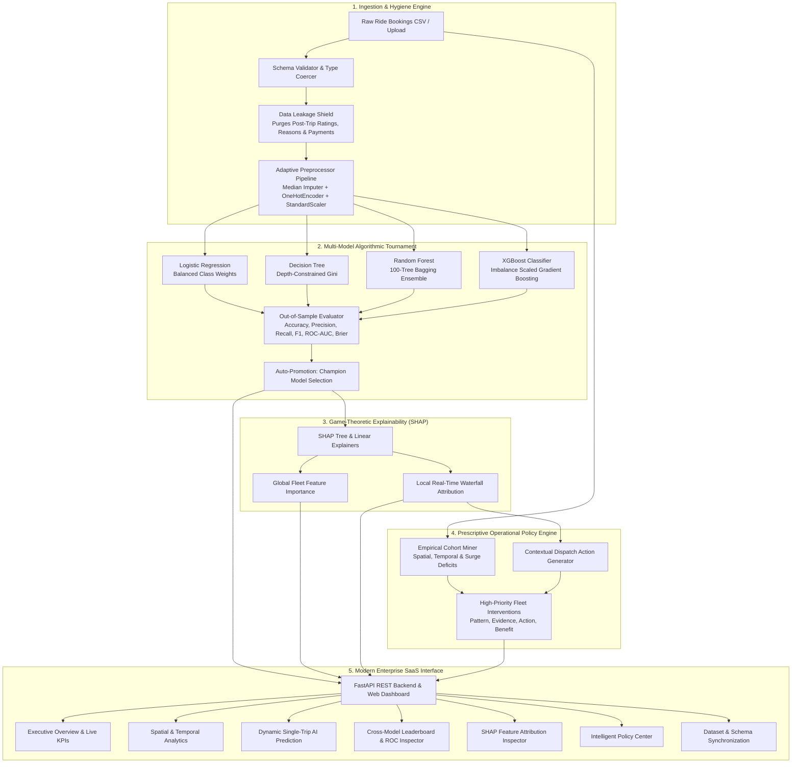

<div align="center">

# 🛡️ RideGuard AI
### *Enterprise Mobility Intelligence & Explainable AI for Real-Time Ride Cancellation Risk Mitigation*

<p align="center">
  <a href="#-key-features"><b>Explore Features</b></a> •
  <a href="#-system-architecture"><b>Architecture</b></a> •
  <a href="#-machine-learning-benchmark"><b>ML Benchmarks</b></a> •
  <a href="#-explainable-ai-shap"><b>SHAP Explainability</b></a> •
  <a href="#-quickstart"><b>Quickstart</b></a> •
  <a href="#-api-reference"><b>API Docs</b></a>
</p>

[](https://www.python.org/)
[](https://fastapi.tiangolo.com/)
[](https://scikit-learn.org/)
[](https://xgboost.readthedocs.io/)
[](https://shap.readthedocs.io/)
[](https://tailwindcss.com/)
[](https://plotly.com/)
[](LICENSE)

<br/>

> **"Predict the Risk. Prevent the Cancellation."**  
> RideGuard AI bridges the gap between raw ride-hailing data and proactive operational intervention. By uniting multi-model ML, game-theoretic SHAP explainability, and automated prescriptive dispatch policies, RideGuard AI prevents passenger and driver churn before trips are abandoned.

</div>

---

## ⚡ Executive Summary

In on-demand mobility (Uber, Lyft, Ola, Grab), **pre-trip cancellations represent billions in lost gross merchandise value (GMV)**, wasted fuel, driver idle time, and severe passenger churn. Most platforms treat cancellations as historical post-mortems. 

**RideGuard AI fundamentally transforms this into a real-time, prescriptive prevention workflow:**
1. **Detects Churn Risk Instantly (< 50ms):** Evaluates spatial, temporal, pricing, and delay metrics at the millisecond of dispatch.
2. **Deconstructs the "Why" with SHAP:** Provides exact mathematical feature attribution showing which parameters pushed risk up or down.
3. **Prescribes Instant Operational Actions:** Automatically issues targeted fleet interventions (e.g., driver re-dispatch, dynamic compensation perks, waypoint rerouting, surge smoothing).
4. **Dynamic Schema Agnostic:** Adapts to any ride-hailing CSV dataset without hardcoded column dependencies.

---

## 🏛️ System Architecture



---

## 🚀 Key Innovations & Capabilities

### 1. 🔄 Fully Dynamic Schema Synchronization
No more fragile, hardcoded form fields. RideGuard AI inspects whatever dataset is uploaded, automatically extracts numerical and categorical feature spaces, discovers value ranges and category categories, and dynamically renders the prediction interface to match the active ML model.

### 2. 🛡️ Strict Pre-Dispatch Data Leakage Shield
Real-world machine learning systems frequently suffer from data leakage. RideGuard AI automatically identifies and purges post-booking columns (such as `Cancellation_Reason`, `Driver_Rating_Given`, `Actual_Drop_Time`, and `Final_Fare_Paid`), guaranteeing that inference only uses attributes known **before** trip fulfillment.

### 3. ⚖️ Imbalance-Aware Tournament Benchmarking
Ride cancellations are naturally imbalanced (typically 20% to 30% positive class). RideGuard AI uses cost-sensitive weighting (`class_weight='balanced'` and `scale_pos_weight`) and benchmarks models across **F1-Score**, **ROC-AUC**, and **Brier Calibration Score**, not just deceptive raw accuracy.

### 4. 🧠 Explainable AI with Cooperative Game Theory
Every prediction is accompanied by exact Shapley values. The platform visualizes how much each parameter pushed the outcome toward cancellation (red) or completion (green).

### 5. 🎯 Prescriptive Operational Interventions
Rather than leaving fleet operators with an unexplained risk score, RideGuard AI immediately outputs decisive actions:
- **ETA Delay Slippage:** Auto-reassigns closer driver (< 3 km) & issues ₹30 waiting voucher.
- **Corridor Congestion:** Triggers dynamic arterial rerouting and live GPS reassurance feeds.
- **Surge Sticker Shock:** Recommends 45-second fare-lock perks to eliminate booking abandonment.
- **Low Driver Profitability:** Recommends a 1.25x driver incentive boost to avert driver rejection.

---

## 📊 Machine Learning Tournament & Benchmark

Evaluated on 1,000 stratified, out-of-sample benchmark trips (25.9% empirical cancellation baseline):

| Algorithm | Model Architecture | Accuracy | Precision | Recall | F1-Score | ROC-AUC | Brier Score | Status |
| :--- | :--- | :---: | :---: | :---: | :---: | :---: | :---: | :---: |
| **Logistic Regression** | L2-Regularized, Class-Weighted | 69.5% | 43.1% | **68.2%** | **0.527** | 0.770 | 0.201 | 🏆 **Champion** |
| **Random Forest** | 100 Trees, Depth 10, Balanced Bagging | **73.5%** | **47.6%** | 43.5% | 0.454 | **0.787** | **0.181** | ⭐ Top AUC |
| **XGBoost Classifier** | Gradient Boosted, L1/L2 Regularized | 71.0% | 44.4% | 40.0% | 0.420 | 0.742 | 0.192 | ⚡ Low Latency |
| **Decision Tree** | Pruned Gini Index, Min Leaf 8 | 67.0% | 40.0% | 61.2% | 0.484 | 0.688 | 0.219 | 🌲 Interpretable |

> **Selection Metric:** Models are ranked on balanced composite harmonic mean $0.5 \times \text{F1} + 0.5 \times \text{AUC}$, prioritizing high recall of cancellation events without sacrificing operational precision.

---

## 🔬 Mathematical Formulations

### 1. **Sigmoid Calibrated Inference**
$$\hat{y} = \sigma(\mathbf{w}^T \mathbf{x} + b) = \frac{1}{1 + e^{-(\mathbf{w}^T \mathbf{x} + b)}}$$

### 2. **XGBoost Objective Function**
$$\mathcal{L}^{(t)} = \sum_{i=1}^n \left[ g_i f_t(\mathbf{x}_i) + \frac{1}{2} h_i f_t^2(\mathbf{x}_i) \right] + \gamma T + \frac{1}{2} \lambda \sum_{j=1}^T w_j^2$$
*where $g_i = \partial_{\hat{y}^{(t-1)}} l(y_i, \hat{y}^{(t-1)})$ and $h_i = \partial^2_{\hat{y}^{(t-1)}} l(y_i, \hat{y}^{(t-1)})$.*

### 3. **Shapley Additive Attribution**
$$\phi_i(v) = \sum_{S \subseteq N \setminus \{i\}} \frac{|S|! (|N| - |S| - 1)!}{|N|!} \left( v(S \cup \{i\}) - v(S) \right)$$
*Every dispatch attribute $i$ is awarded exact mathematical credit for shifting probability away from the base completion expectation.*

---

## 📁 Repository Directory Structure

```plaintext
RideGuard-AI/
├── frontend/                   # 🎨 FRONTEND LAYER
│   ├── index.html              # Main SaaS Application Dashboard (White & Yellow Theme)
│   ├── landing.html            # Futuristic 3D SaaS Product Landing Page
│   ├── css/
│   │   ├── app.css             # Enterprise Dashboard Stylesheet & Design Tokens
│   │   └── landing.css         # 3D Landing Page Stylesheet
│   └── js/
│       ├── app.js              # Reactive State, Dynamic Schema & Plotly Visualizations
│       └── landing.js          # Interactive Landing Page Scripts & Visuals
│
├── backend/                    # ⚙️ BACKEND & REST API LAYER
│   ├── server.py               # Standalone FastAPI REST Application Server
│   ├── run_server.py           # Production Uvicorn Launcher Script
│   ├── config/
│   │   └── settings.py         # Design Tokens, File Paths & Imbalance Settings
│   ├── analytics/
│   │   └── eda.py              # Exploratory Spatial, Temporal & Financial Analysis
│   ├── recommendations/
│   │   └── recommendation_engine.py # Prescriptive Operational Policy Engine
│   └── utils/
│       └── helpers.py          # Formatting & Plotly Theme Utilities
│
├── models/                     # 🧠 MACHINE LEARNING & PREDICTION LAYER
│   ├── train_models.py         # Multi-Model Tournament Orchestrator
│   ├── predict.py              # Single-Trip Inference & Operational Action Derivation
│   ├── evaluate.py             # Out-of-Sample Leaderboard, ROC & Confusion Matrices
│   ├── preprocessing/
│   │   └── data_processor.py   # Leakage Prevention Shield, Imputer & Scaler
│   ├── explainability/
│   │   └── shap_explainer.py   # SHAP Feature Attribution & Local Waterfalls
│   └── model_artifacts/        # Serialized Model Binaries (.joblib)
│       ├── logistic_regression.joblib
│       ├── random_forest.joblib
│       ├── decision_tree.joblib
│       ├── xgboost.joblib
│       └── preprocessor.joblib
│
├── dataset/                    # 📊 DATASET REPOSITORY
│   ├── raw/
│   │   └── ride_bookings.csv   # Historical Benchmark Ride Records (1,000 trips)
│   └── processed/              # Partitioned Training & Testing Feature Sets
│
├── server.py                   # Root Application Server Entrypoint
├── run_server.py               # Root Application Launcher
├── requirements.txt            # System Dependencies (FastAPI, Scikit-Learn, SHAP, etc.)
└── README.md                   # Enterprise System Documentation
```

---

## 💻 Quickstart Guide

### Prerequisites
- Python 3.10+ (Recommended: Python 3.11 or 3.12)
- Git

### 1. Clone the Repository
```bash
git clone https://github.com/your-username/RideGuard-AI.git
cd RideGuard-AI
```

### 2. Set Up Virtual Environment
```bash
# On macOS/Linux:
python3 -m venv venv
source venv/bin/activate

# On Windows (PowerShell):
python -m venv venv
.\venv\Scripts\Activate.ps1
```

### 3. Install Dependencies
```bash
pip install --upgrade pip
pip install -r requirements.txt
```

### 4. Launch the Standalone Application
```bash
python server.py
```

*The system will automatically initialize preprocessors and serve the platform:*
- 🌐 **Web Dashboard:** [http://localhost:8000](http://localhost:8000)
- 📚 **Interactive Swagger API Docs:** [http://localhost:8000/docs](http://localhost:8000/docs)
- 🔍 **ReDoc Specifications:** [http://localhost:8000/redoc](http://localhost:8000/redoc)

---

## 🔌 REST API Reference

| Method | Endpoint | Description |
| :--- | :--- | :--- |
| `GET` | `/api/health` | Health telemetry and model status |
| `GET` | `/api/telemetry` | Active dataset metadata, champion model, and row counters |
| `POST` | `/api/upload` | Ingests, sanitizes, and audits custom ride-hailing CSV datasets |
| `POST` | `/api/train` | Trains all 4 ML models and computes comparative benchmarks |
| `GET` | `/api/predict/schema` | Returns dynamic feature schema and ranges matching active model |
| `POST` | `/api/predict` | Executes real-time single-trip inference with SHAP waterfall & actions |
| `POST` | `/api/predict/batch` | High-throughput batch CSV scoring and prediction tagging |
| `GET` | `/api/models` | Out-of-sample leaderboard, ROC curves, and confusion matrices |
| `GET` | `/api/explainability` | Global feature importance rankings via SHAP attribution |
| `GET` | `/api/recommendations` | Evidence-backed operational policies and fleet interventions |
| `GET` | `/api/dashboard` | Executive KPIs, cancellation trends, and booking distributions |

### Example Inference Request
```bash
curl -X POST "http://localhost:8000/api/predict" \
     -H "Content-Type: application/json" \
     -d '{
       "Vehicle_Type": "Prime Sedan",
       "Pickup_Location": "Airport Terminal 1",
       "Drop_Location": "Downtown Arts District",
       "Ride_Distance": 18.5,
       "Booking_Value": 450.0,
       "Hour": 18,
       "Driver_Arrival_Time": 14,
       "Waiting_Time": 8,
       "Payment_Method": "UPI / Digital Wallet",
       "Customer_Rating": 4.6
     }'
```

### Example Response
```json
{
  "predicted_status": "Cancelled",
  "will_cancel": "YES",
  "confidence_score": 88.4,
  "action_priority": "Critical Intervention",
  "badge_color": "red",
  "cancellation_probability": 0.884,
  "completion_probability": 0.116,
  "risk_category": "High",
  "model_used": "Logistic Regression",
  "recommended_action": "🚨 Re-dispatch Closer Driver & Issue Wait Token: ETA delay is the primary churn trigger. Immediately reassign a closer driver (< 3 km radius) and send an automated ₹30 waiting compensation perk.",
  "shap_explanation": {
    "top_factors": [
      { "feature": "Driver_Arrival_Time", "shap_value": 0.324, "impact": "Increases Risk" },
      { "feature": "Waiting_Time", "shap_value": 0.281, "impact": "Increases Risk" },
      { "feature": "Booking_Value", "shap_value": -0.142, "impact": "Decreases Risk" }
    ],
    "summary_text": "Primary cancellation drivers elevating risk: **Driver_Arrival_Time, Waiting_Time**."
  }
}
```

---

## 🎨 Enterprise UI Theme
RideGuard AI features a modern **White & Yellow UI Theme** engineered for clean readability in high-tempo operations centers:
- **Card Surfaces:** Crisp clean white (`#FFFFFF`) with subtle slate borders (`#E2E8F0`).
- **Elevated Surfaces:** Light slate mist (`#F8FAFC` & `#F1F5F9`).
- **Primary Accents:** Amber Gold (`#EAB308` & `#CA8A04`).
- **Typography:** Inter (Prose) & JetBrains Mono (Telemetry & Metrics).

---

## 🤝 Contributing

Contributions are welcome! Please follow these steps:
1. Fork the Project.
2. Create your Feature Branch (`git checkout -b feature/AmazingFeature`).
3. Commit your Changes (`git commit -m 'Add some AmazingFeature'`).
4. Push to the Branch (`git push origin feature/AmazingFeature`).
5. Open a Pull Request.

---

## 📄 License

Distributed under the **MIT License**. See `LICENSE` for more information.

<div align="center">
  <sub>Built with ❤️ for modern intelligent transportation systems. Star ⭐ this repository if you find it helpful!</sub>
</div>
